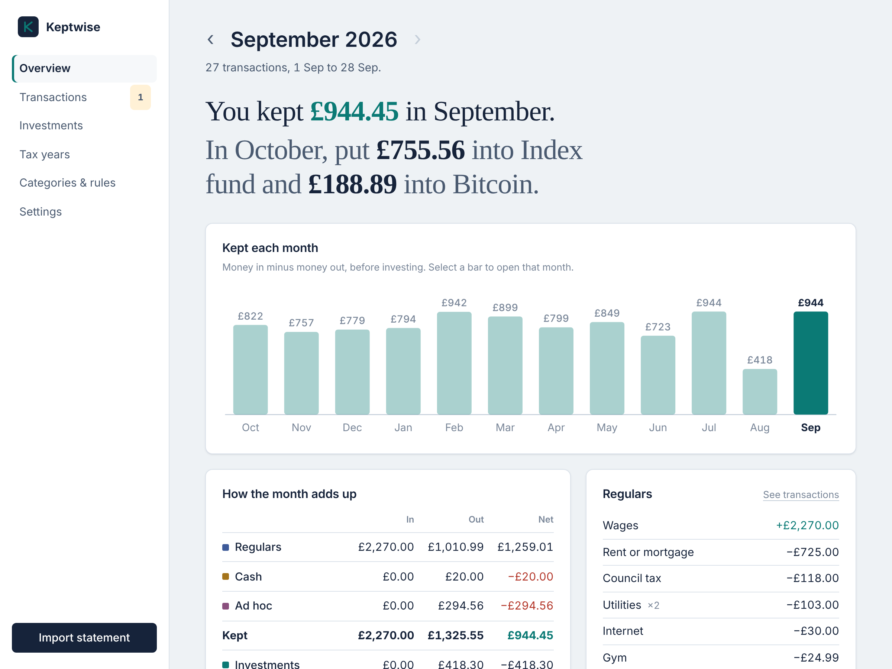
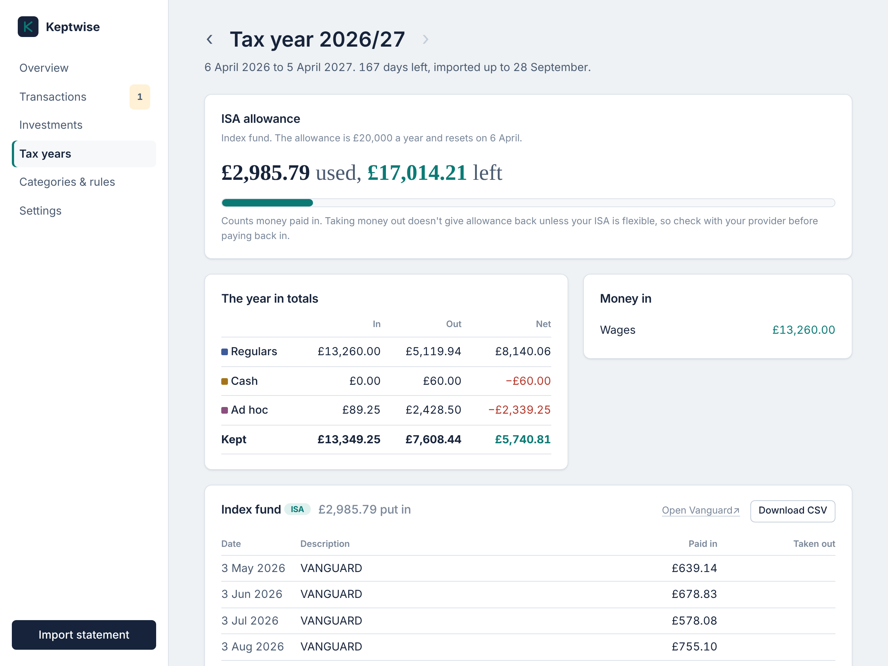
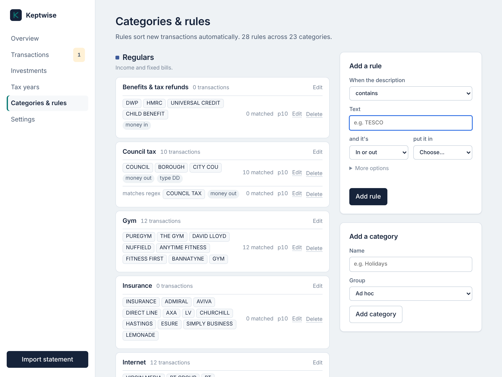
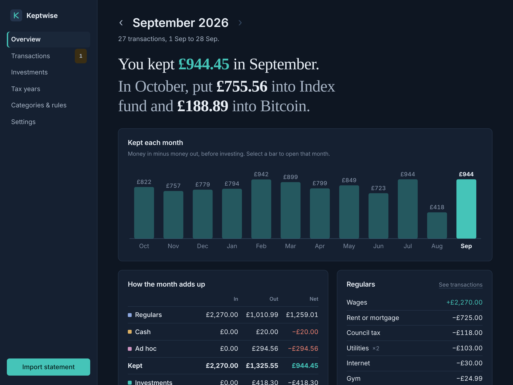
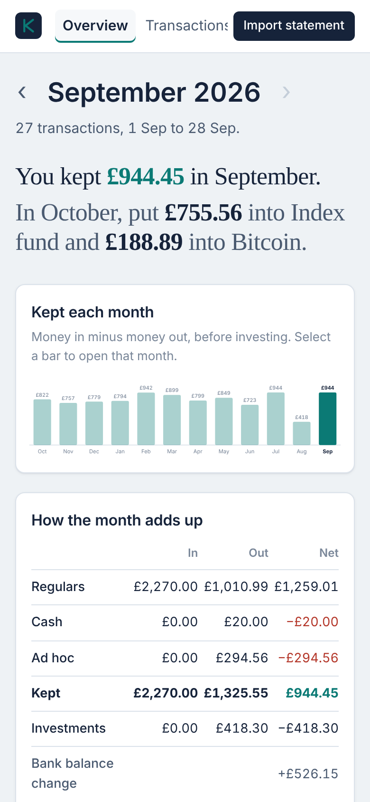

# Keptwise

Import last month's bank statement, see where the money went, and know exactly how much
to invest.

Keptwise is a small app that runs on your own computer. Once a month you download your
current account's transactions as a CSV and drop them in. It sorts every transaction,
shows what you kept, and splits that between your investments by the percentages you
choose: "In October, put £755.56 into your index fund and £188.89 into Bitcoin."

Your data never leaves your computer. There are no accounts, no cloud and no bank logins.



> **Built for the UK, for now.** Amounts are in pounds, tax years run 6 April to 5 April,
> and the ISA allowance is tracked. Support for other currencies and tax years is
> planned. If you'd like it for your country, see [Contributing](CONTRIBUTING.md).

## Try it

You need [uv](https://docs.astral.sh/uv/). It installs the right Python for you.

```sh
# macOS
brew install uv
# macOS and Linux
curl -LsSf https://astral.sh/uv/install.sh | sh
# Windows (PowerShell)
powershell -ExecutionPolicy ByPass -c "irm https://astral.sh/uv/install.ps1 | iex"
```

Then:

```sh
git clone https://github.com/indigoape/keptwise.git
cd keptwise
uv run keptwise demo     # a made-up year of data, to look around
uv run keptwise serve    # your own data
```

The demo uses its own database, on port 8766, so it never mixes with your data. Run it
again any time to start it afresh, and stop it with `keptwise stop --port 8766`.

`keptwise serve` opens <http://127.0.0.1:8765> in your browser. A short setup asks for
your bank and what you invest in (both optional), then you import your first statement.

## How it works

Every transaction lands in one of four groups:

| Group | What's in it |
|---|---|
| **Regulars** | Income and fixed bills: wages, rent, council tax, energy, phone… |
| **Cash** | Cash machines, and transfers between your own accounts |
| **Investments** | Payments to the platforms you invest with |
| **Ad hoc** | Everything else: groceries, eating out, shopping, trips… |

**Kept** is the net of Regulars, Cash and Ad hoc: what your balance did before you
invested. Next month, that's split between your investments by percentage. If a month
ran over, it tells you there's nothing to invest.

## Each month

1. Download last month's transactions from your bank as a CSV.
2. Choose **Import statement** and drop the file in.
3. If anything wasn't categorised, the import page links straight to it. Pick a category
   and accept the offer to make it a rule.
4. Open the month's overview. It says what you kept and how much to put into each
   investment.

## Features

- **Import from most UK banks.** Lloyds, Halifax and Bank of Scotland CSVs work as they
  are. The importer also recognises the column layouts that Monzo, Starling, Nationwide
  and others use. Overlapping statements are fine: duplicates are skipped.
- **Automatic categories.** A starter set of rules covers common UK billers and chains.
  When you categorise something by hand, the app offers to remember it for next time.
- **Month overview.** What you kept and what to invest, a chart of every month, how the
  four groups add up, your bills, and ad hoc spending by category.
- **Worth a look.** It points out a bill that hasn't gone out, a fixed bill whose price
  changed, or spending well above or below normal, judged against your own last 12
  months.
- **Investments.** Planned against actually invested, month by month, with links to log
  in to each platform.
- **Tax years.** Totals for each April-to-April year, your ISA allowance used and left,
  and every payment to each platform as a CSV for your records.
- **Monthly reminder.** One click adds a repeating Apple Calendar or Outlook event, and a
  banner tells you exactly which dates to download.
- **Safe.** Automatic daily backups, and a backup before every upgrade.
- **Light and dark mode,** and it works on a phone-sized screen.

| Tax year and ISA allowance | Rules with a live preview |
|---|---|
|  |  |

| Dark mode | On a phone |
|---|---|
|  |  |

All screenshots use the made-up data from `keptwise demo`.

## Where your data is kept

When you run Keptwise from the cloned folder, your data is in `data/keptwise.db` inside
that folder. If you install it as a package instead, it goes in your user data folder:

- macOS: `~/Library/Application Support/Keptwise`
- Linux: `~/.local/share/keptwise`
- Windows: `%APPDATA%\Keptwise`

Settings shows the exact path. Set `KEPTWISE_DB=/path/to/file.db` to choose your own.
Daily backups go in a `backups` folder next to the database, and the newest 30 are kept.

## Starting it without a terminal (macOS)

Double-click `Keptwise.command` in Finder. The first time, right-click it and choose
**Open**. Close the window to stop the app.

## Command line

```sh
uv run keptwise serve                      # start and open the app
uv run keptwise serve --idle-timeout 60    # stop after an hour unused
uv run keptwise import statement.csv       # import without the app
uv run keptwise summary                    # latest month in the terminal
uv run keptwise summary 2026-06            # a specific month
uv run keptwise recategorise               # re-apply rules to everything
uv run keptwise stop                       # stop an app running in the background
uv run keptwise demo                       # try it with made-up data
```

## Security

Keptwise is a single-user app for your own computer. It listens on `127.0.0.1` only and
has no login, so don't expose it on a network. See [SECURITY.md](SECURITY.md).

## Why no direct bank connection?

UK banks only share account data with FCA-authorised providers. The free options for
individuals either don't cover UK banks or are closed to new users, and the rest are paid
business products. Downloading a CSV once a month keeps the app free, private and
independent of any third party.

## Development

```sh
uv run pytest                      # tests
uv run ruff check .                # lint
uv run ruff format .               # format
uv run keptwise serve --debug      # auto-reload while editing
```

It's deliberately small, with few dependencies: Flask and Click, SQLite from Python's
standard library, and charts drawn on the server as SVG. There's no JavaScript build step,
and it works offline.

```
src/keptwise/
  importer.py     CSV parsing (bank column detection) and duplicate detection
  rules.py        rule matching and categorisation
  seed.py         starter categories and rules for new databases
  investments.py  investment platforms, split and statement text
  reports.py      monthly summaries, the investment plan, tax years
  insights.py     normal ranges, unusual months, missing or changed bills
  categories.py   merging categories
  money.py        pence and pounds formatting
  dates.py        date formatting that works on every system
  demo.py         the made-up year behind `keptwise demo`
  db.py           SQLite schema, migrations and backups
  cli.py          command line
  web/            Flask app: views, templates, CSS, SVG charts
tests/            pytest suite with made-up statements
```

Contributions are welcome, especially support for more banks. See
[CONTRIBUTING.md](CONTRIBUTING.md).

## Licence

Copyright © 2026 Jamie Baxter.

Keptwise is free software: you can redistribute it and/or modify it under the terms of
the [GNU General Public License](LICENSE), version 3 or (at your option) any later
version. It comes with no warranty.

In short, you can use, change and share it, even commercially, as long as anything you
distribute stays under the GPL with its source code available.
